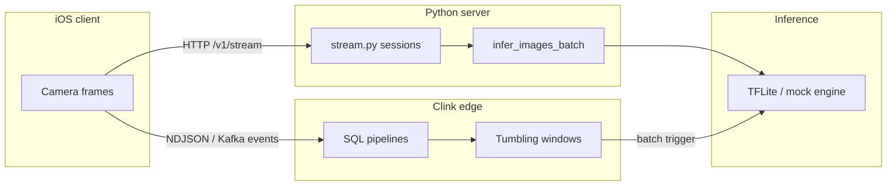

# Clink stream processing for Music Vision

This note explains how [Clink](https://github.com/orhaugh/clink) relates to Apache Flink and the stream batching already in Music-app.

## What is Clink?

Clink is a **C++23, Arrow-native stream processing engine** licensed under Apache 2.0. It is **heavily inspired by Apache Flink** — same core ideas:

- Typed operator DAGs
- Event time and watermarks
- Keyed state and window operators
- Checkpoint barriers and exactly-once semantics

Clink reimplements that model for **embedded and JVM-free deployment**: one static binary, millisecond cold start, Arrow IPC checkpoints, and optional distributed Coordinator/Worker mode using the **same SQL file**.

There is **no official Apache project called “Apache Clink”**. The name pairs Clink (the engine) with its Flink lineage and Apache license.

## Three stream paths in this repo



| Approach | Location | Best for |
| --- | --- | --- |
| **In-memory HTTP sessions** | `server/inference/stream.py` | Fast path from iOS `ServerSideStreamSession`; count + time auto-flush |
| **Clink SQL (embedded)** | `edge/clink/` | Edge Pi / LAN aggregation, Flink-like windows, replayable state |
| **Apache Flink (external)** | Not bundled | Large multi-tenant clusters, mature connector ecosystem |

## Mapping Python stream settings to Clink

The Python `StreamSessionManager` exposes:

| Python env / field | Meaning | Clink equivalent |
| --- | --- | --- |
| `batch_size` | Flush when pending frames ≥ N | `COUNT(*)` threshold in a keyed aggregate or custom process function |
| `max_wait_ms` | Flush after oldest frame age | `TUMBLE(ts_ms, INTERVAL '…')` or `HOP` windows |
| `idle_ttl_ms` | Drop inactive sessions | Session timeout in keyed state or external TTL on session keys |
| `session_id` | Per-camera stream key | `GROUP BY session_id` |

Example pipelines live under [`edge/clink/pipelines/`](../edge/clink/pipelines/).

## When to choose Clink over Flink

Choose **Clink** when:

- You need native embedding on Pi or in a C++/Python service (`libclink`, `pyclink`)
- JVM footprint and ops complexity are unacceptable on edge hardware
- State should be **open Arrow IPC** (inspectable in DuckDB/Polars)
- The same SQL should run in-process **and** on a small cluster later

Choose **Apache Flink** when:

- You already operate a Flink cluster and connector catalog at scale
- You need battle-tested multi-year production history across many teams
- JVM ecosystem tooling (Flink SQL, PyFlink, managed offerings) is a hard requirement

For Music-app’s current scale (iOS + Pi + optional LAN server), **Python stream sessions** cover the happy path; **Clink** is the upgrade path when you need Flink semantics without standing up Flink.

## Sample event schema

Events in [`edge/clink/sample_events.ndjson`](../edge/clink/sample_events.ndjson) mirror what you might emit from analytics or a thin ingest adapter:

```json
{
  "ts_ms": 1240,
  "session_id": "sess-ios-001",
  "frame_id": "f-004",
  "model": "music_vision_efficientnet",
  "channel": "production",
  "device_class": "ios",
  "latency_ms": 40.5
}
```

Image bytes stay outside Clink — only metadata flows through the stream engine, matching how `stream.py` batches `image_bytes` separately from session bookkeeping.

## Try it

```bash
./edge/clink/run_pipeline.sh music_vision_batch
./edge/clink/run_pipeline.sh music_vision_windows
```

## References

- Clink repository: https://github.com/orhaugh/clink
- Clink documentation: https://orhaugh.github.io/clink/
- Apache Flink: https://flink.apache.org/
- Music-app stream API: [`server/inference/README.md`](../server/inference/README.md)
