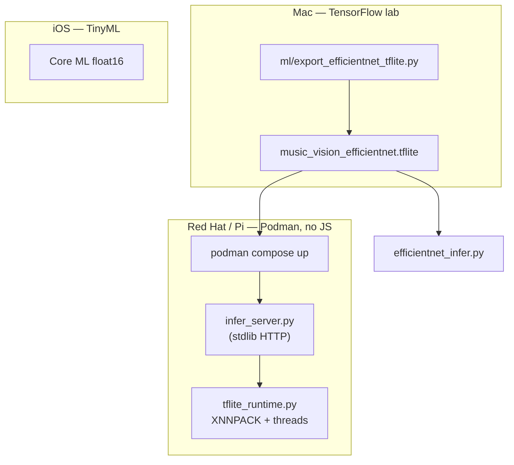

# Model compression and edge deployment

Music Vision uses **device-tiered models**: TinyML on iOS phones, EfficientNet on Raspberry Pi, and SavedModel/TFLite on servers. This guide covers **compressing** the Pi model and **deploying** it on small Pis, Red Hat Linux, and Podman — with **no JavaScript** anywhere in the edge stack.

## Why compression matters on small Pis

| Constraint | Without compression | With dynamic/int8 TFLite |
| --- | --- | --- |
| Model size | ~15–20 MB float32 | ~4–8 MB dynamic, ~3–5 MB int8 |
| RAM at load | Higher peak | Lower — critical on 512 MB–1 GB Pis |
| Inference latency | Baseline | Often 1.5–3× faster with XNNPACK |
| Power / thermals | Higher CPU duty cycle | Better for always-on edge nodes |

Phones stay on **TinyML / MobileNet** (Core ML float16). Pis get **EfficientNet TFLite** because they are plugged in and have more headroom — but still benefit from quantization.

## Compression pipeline (run on Mac or CI)

```bash
# One-time setup on your Mac TensorFlow lab (see docs/mac-tensorflow-lab.md)
python3 -m venv .venv-export
source .venv-export/bin/activate
pip install -r ml/requirements-export-tflite.txt

# Quick stub for smoke tests (EfficientNet-Lite0 + your label count)
python3 ml/export_efficientnet_tflite.py --export-stub --quantize dynamic

# From your fine-tuned Keras model
python3 ml/export_efficientnet_tflite.py \
  --from-keras path/to/music_vision.keras \
  --quantize float16

# Smallest / fastest — needs calibration images
python3 ml/export_efficientnet_tflite.py \
  --from-keras path/to/music_vision.keras \
  --quantize int8 \
  --calibration-dir ml/calibration_images/
```

Output lands in `edge/raspberry_pi/models/music_vision_efficientnet.tflite` plus an `_export_manifest.json` with size and quantization metadata.

### Quantization modes

| Mode | When to use | Calibration needed |
| --- | --- | --- |
| `none` | Accuracy baseline | No |
| `float16` | Good shrink, minimal accuracy loss | No |
| `dynamic` | **Default for Pi** — strong size/latency win | No |
| `int8` | Smallest and fastest on ARM | Yes (~100 RGB images) |

Preprocess contract (all modes): RGB **224×224**, scale to **[-1, 1]** via `(pixel / 127.5) - 1`. Int8 models accept **0–255** uint8 at the TFLite boundary (handled automatically in `tflite_runtime.py`).

## Inference optimization on the Pi

```bash
# Single image
python3 edge/raspberry_pi/efficientnet_infer.py \
  --image album.jpg \
  --threads 4

# Benchmark thread counts and XNNPACK
python3 edge/raspberry_pi/benchmark.py \
  --image album.jpg \
  --threads 1,2,4 \
  --runs 20
```

Optimizations built in:

- **XNNPACK delegate** — CPU acceleration (enabled by default)
- **Thread count** — set `--threads` to Pi core count (4 on Pi 4/5)
- **Quantized models** — uint8 inputs/outputs handled in the runtime

Typical Pi 4 results (dynamic quant, 224×224): ~80–150 ms/image depending on threads and SD card I/O.

## Red Hat / Linux + Podman (no JavaScript)

The edge stack is **Python only**: TFLite runtime, Pillow, numpy, stdlib HTTP server. No Node, no browser runtime.

### On RHEL / Fedora / Pi OS with Podman

```bash
# Export model on Mac first, copy models/ to the Pi or bind-mount locally
chmod +x edge/raspberry_pi/up.sh
./edge/raspberry_pi/up.sh

# Or explicitly:
podman compose -f edge/raspberry_pi/compose.yaml up -d --build
```

**SELinux hosts** (RHEL, Fedora): the compose file uses `:Z` on the model volume. If you still get permission errors:

```bash
chcon -Rt container_file_t edge/raspberry_pi/models/
```

### HTTP API (stdlib — no JS)

```bash
# Health
curl http://127.0.0.1:8088/health

# JSON infer (base64 image)
curl -X POST http://127.0.0.1:8088/v1/infer \
  -H 'Content-Type: application/json' \
  -d '{"image_b64": "'$(base64 -w0 album.jpg)'", "top_k": 3}'
```

### Rootless Podman on RHEL

```bash
sudo dnf install -y podman podman-compose
podman machine init --now   # only on macOS; on RHEL use native podman
./edge/raspberry_pi/up.sh
```

## Architecture overview



## Related docs

- [`edge/raspberry_pi/README.md`](../edge/raspberry_pi/README.md) — Pi setup and CLI
- [`docs/mac-tensorflow-lab.md`](mac-tensorflow-lab.md) — export and Serving on Apple Silicon
- [`serving/README.md`](../serving/README.md) — cloud TensorFlow Serving (Podman)
- [`ml/tinyml/README.md`](../ml/tinyml/README.md) — iOS TinyML compression
