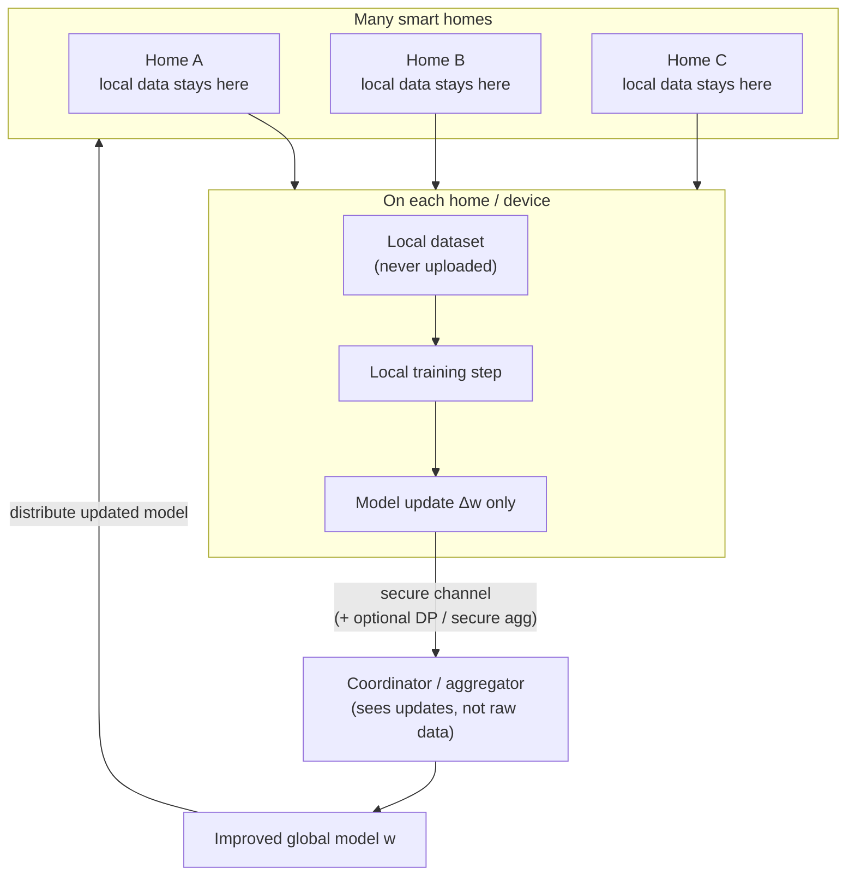
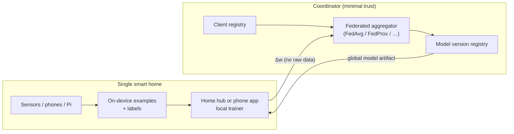

# Notes: Federated Learning in Smart Homes for Personal Information Privacy

**Date:** August 23, 2026  
**Project:** [Music-app](https://github.com/monkeymakes/Music-app)  
**Captured via:** Mobile voice dictation

---

## Presented notes (verbatim)

> Fl in smart homes maintains personal information privacy

---

## Interpreted intent

| Item | Detail |
|------|--------|
| **Topic** | Federated Learning (FL) |
| **Domain** | Smart homes (sensors, hubs, phones, edge devices) |
| **Goal** | Maintain personal information privacy while still training useful models |
| **Core claim** | FL keeps raw personal data on-device; only model updates leave the home |
| **Deliverable** | Notes + architecture + work plan to explore FL as a privacy-preserving path for home/edge ML |

---

## Summary

**Federated Learning (FL)** trains a shared model across many smart-home devices **without centralizing raw personal data**. Each home (or device) trains locally on its own sensor, voice, camera, or usage data; only **encrypted or aggregated model updates** are sent to a coordinator. The global model improves for everyone while **personal information stays inside the home**.

For Music-app and related edge/vision work, FL is the privacy-first alternative to “upload everything to the cloud and train there.”

---

## Why smart homes need this

Smart homes continuously collect sensitive signals:

| Signal | Examples | Privacy risk if centralized |
|--------|----------|-----------------------------|
| Presence & routine | Motion, door, occupancy | Reveals when people are home or away |
| Audio | Voice assistants, baby monitors | Conversations, health, identity |
| Vision | Doorbell, room cameras | Faces, visitors, layout of the home |
| Energy & appliances | Smart plugs, HVAC | Lifestyle and medical inference |
| Media / preference | What is played, when | Habits, household composition |

Centralized training requires shipping this data to a server. That creates storage liability, breach surface, regulatory exposure (GDPR/CCPA), and user distrust. **FL reduces that by design: train where the data already lives.**

---

## How FL maintains personal information privacy



### Privacy properties (what FL gives you)

1. **Data localization** — Raw personal records never leave the device or home hub.
2. **Update-only egress** — The network sees weight deltas (or gradients), not sensor streams.
3. **Collective learning** — Homes benefit from a better shared model without pooling private datasets.
4. **Composable defenses** — Pair FL with differential privacy (DP), secure aggregation, and TLS so even updates are harder to abuse.

### What FL does *not* automatically guarantee

FL is privacy-preserving **relative to raw data upload**, but updates can still leak information if an adversary is sophisticated. Harden with:

| Control | Role |
|---------|------|
| **Differential privacy (DP)** | Noise on updates so individuals are hard to re-identify |
| **Secure aggregation** | Server only sees the sum of updates, not any single home’s update |
| **TLS / mTLS** | Protect updates in transit |
| **Device auth & enrollment** | Stop rogue clients from poisoning the model |
| **Update clipping / anomaly checks** | Limit influence of any one home |
| **Minimize retained logs** | Don’t log raw features “for debugging” on the server |

---

## Smart-home FL architecture (target sketch)



### Roles

| Component | Runs where | Responsibility |
|-----------|------------|----------------|
| **Local trainer** | Phone, hub, Raspberry Pi | Train on local data; emit update |
| **Coordinator** | Internal or cloud service | Select clients, aggregate, publish new global weights |
| **Model registry** | Same as Music-app versioning ideas | Version global checkpoints; pin clients to compatible builds |
| **Optional DP / secure agg** | Client and/or aggregator | Strengthen privacy beyond “data stays local” |

### Typical round (FedAvg-style)

1. Coordinator picks a subset of enrolled homes/devices.
2. Each selected client downloads the current global model.
3. Client trains for a few local steps on **its own** data.
4. Client sends **only** the weight update (clipped / noised if using DP).
5. Coordinator aggregates (e.g. weighted average by local sample count).
6. New global model is published; clients pull on the next round or app launch.

---

## Fit with Music-app / edge ML work already in this repo

Prior branches explored on-device TinyML/Core ML, Raspberry Pi EfficientNet, and server-side TensorFlow Serving. FL sits between those poles:

| Approach | Where data lives | Privacy | Latency |
|----------|------------------|---------|---------|
| **On-device only** (TinyML / Core ML) | Device | Strongest (no training egress) | Best for inference |
| **Federated Learning** | Device for training; updates leave | Strong if DP + secure agg | Training is async/background |
| **Centralized / server inference** | Cloud | Weakest for personal data | Depends on network |

**Practical recommendation for this project**

- Keep **inference** on-device (existing Music Vision path).
- Use **FL only when you need the model to improve from many homes’ labeled examples** without collecting those examples centrally (e.g. household-specific false-positive feedback, preference models, anomaly detectors).
- Reuse the **model version registry** idea so federated checkpoints are pinned and rollbacks are possible.

---

## Threat model (concise)

| Adversary | FL without extras | FL + DP + secure aggregation |
|-----------|-------------------|------------------------------|
| Curious cloud operator | Sees per-client updates | Sees aggregate (or noisy) updates only |
| Network eavesdropper | Needs TLS | TLS still required |
| Malicious home device | Can poison updates | Clipping, auth, anomaly filters help |
| Honest-but-curious neighbor | Cannot read your raw data | Same; no cross-home data share |

Assumption to document for any implementation: **the home is the trust boundary for raw data**; the coordinator is **not** fully trusted with personal information.

---

## Work plan

### Phase 0 — Scope the privacy story

- Write a one-page privacy claim: *“Raw smart-home personal data never leaves the premises; only model updates do.”*
- List which Music-app / home signals would ever be used for FL (and which must remain inference-only).
- Decide success criteria: e.g. measurable model improvement with zero raw dataset upload.

### Phase 1 — Simulation first (no real homes)

Prove the loop before wiring devices:

```text
docs/notes/  →  this document
fl/sim/      →  (future) FedAvg simulator on partitioned toy data
```

- Partition a public dataset into “homes.”
- Run FedAvg for N rounds; compare to centralized training accuracy.
- Measure: communication size per round, convergence, effect of DP noise.

### Phase 2 — On-device local trainer prototype

Target one client type first (prefer iOS or Raspberry Pi, matching existing stacks):

| Client | Local stack hint |
|--------|------------------|
| iOS | Core ML / TFLite local fine-tune or last-layer update |
| Raspberry Pi | Python + TFLite / PyTorch local steps |

Deliverable: client loads global weights → trains on a **local-only** folder → exports `update.bin` / tensor payload.

### Phase 3 — Minimal coordinator

- Enrollment token per home/device.
- Round scheduling (manual cron is fine at first).
- FedAvg aggregation + write new version to a model registry (align with existing version-resolver patterns).
- TLS only; no raw feature logging.

### Phase 4 — Privacy hardening

- Gradient / update clipping.
- Optional DP-SGD or Gaussian noise on updates.
- Secure aggregation (or at least batch-only visibility of sums).
- Poisoning checks: reject oversized or NaN updates.

### Phase 5 — Smart-home integration checklist

- [ ] Raw sensor/media buffers never leave the LAN
- [ ] Only signed model updates leave the home
- [ ] Users can opt out of FL rounds
- [ ] Clear in-app copy: what stays local vs what is shared
- [ ] Rollback path if a federated round degrades quality
- [ ] Audit log of rounds (metadata only: round id, client count, model version — not personal data)

---

## Glossary

| Term | Meaning |
|------|---------|
| **FL** | Federated Learning — distributed training without pooling raw data |
| **FedAvg** | Federated Averaging — classic aggregator (McMahan et al.) |
| **DP** | Differential Privacy — mathematical bound on individual influence / leakage |
| **Secure aggregation** | Crypto so the server learns only the sum of updates |
| **Personal information** | Data that identifies or describes people in the home (audio, video, routines, identifiers) |

---

## Bottom line

**Federated Learning in smart homes maintains personal information privacy** by keeping raw household data on local devices and sharing only model updates (ideally with DP and secure aggregation). That matches a privacy-first smart-home ML strategy: learn collectively, store personally identifiable data locally.
