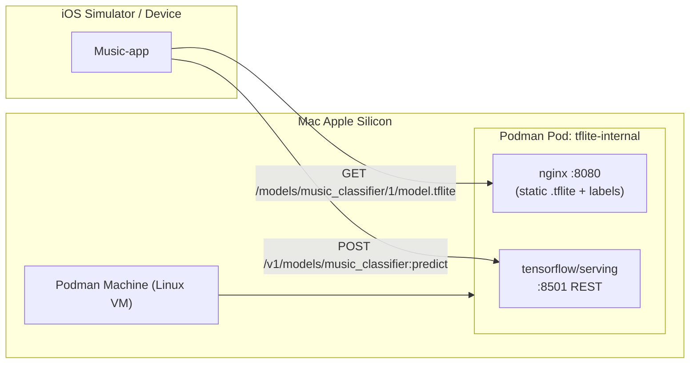

# Notes: Internal TensorFlow Lite Server (macOS Apple Silicon)

**Date:** August 17, 2026  
**Project:** [Music-app](https://github.com/monkeymakes/Music-app)  
**Captured via:** Mobile voice dictation

---

## Presented notes (verbatim)

> Immediate reaction plan in order to prove how models work I wanna host an internal pod man tensor Server that serves tensor flow light in iOS files I need a work plan to build it on a Mac OS for silicone

---

## Interpreted intent

| Item | Detail |
|------|--------|
| **Goal** | Prove how ML models work end-to-end |
| **Approach** | Host an internal Podman-based tensor server |
| **Serves** | TensorFlow Lite (`.tflite`) files for iOS |
| **Platform** | macOS on Apple Silicon (M-series) |
| **Deliverable** | A work plan to build it |

---

## Summary

To validate the full model lifecycle for Music-app, stand up an **internal-only** model server on a Mac using **Podman**. The server distributes or runs `.tflite` artifacts so the iOS app can either download models for on-device inference or call a REST predict endpoint. Two proof tracks are available:

| Track | What it proves | iOS role |
|-------|----------------|----------|
| **A — Model distribution** | Models are versioned artifacts, downloaded like any asset | On-device inference with `TensorFlowLiteSwift` |
| **B — Server inference** | Same model runs remotely; iOS sends input, gets predictions | HTTP client to TensorFlow Serving REST API |

For Music-app, Track A fits production (low latency, offline). Track B is the fastest “models are just APIs” demo.

---

## Work plan

### Architecture (target state)



Internal-only means: bind to localhost or a private LAN IP, no public ingress, optional mTLS later.

---

### Phase 0 — Mac prerequisites (≈30 min)

**Install tooling**

```bash
brew install podman podman-compose curl jq
# Optional GUI:
brew install --cask podman-desktop
```

**Initialize Podman VM (Apple Silicon)**

Use `applehv` (stable default on Apple Silicon):

```bash
export CONTAINERS_MACHINE_PROVIDER=applehv
podman machine init \
  --cpus 4 \
  --memory 8192 \
  --disk-size 50 \
  --now

podman machine start
podman info | grep -E 'arch|OS|provider'
```

**Persist provider** in `~/.config/containers/containers.conf`:

```ini
[machine]
provider = "applehv"
```

**Verify ARM64 images pull cleanly**

```bash
podman pull --arch arm64 docker.io/tensorflow/serving:latest
podman pull --arch arm64 docker.io/library/nginx:alpine
```

If an image has no ARM build, add Rosetta only when needed:

```bash
CONTAINERS_MACHINE_ROSETTA=true podman machine init --now
```

---

### Phase 1 — Repo layout on the Mac (≈20 min)

Create a small ops folder (can live beside the Music-app repo):

```text
tflite-server/
├── models/
│   └── music_classifier/
│       └── 1/
│           ├── model.tflite      # required for TF Serving TFLite mode
│           └── labels.txt        # optional, for classification demos
├── nginx/
│   └── default.conf
├── serving/
│   └── models.config             # optional multi-model config
├── podman-compose.yml            # or use `podman pod create`
└── scripts/
    ├── smoke-test.sh
    └── convert-to-tflite.py      # if you start from Keras/SavedModel
```

**Model directory rule (critical for TensorFlow Serving):**

```text
/models/<MODEL_NAME>/<VERSION>/model.tflite
```

Example:

```text
models/music_classifier/1/model.tflite
```

Without the version folder (`1/`), Serving will not load the model.

---

### Phase 2 — Get a `.tflite` file (≈1–2 hrs)

**Fastest proof model:** use a public TFLite sample (flower classifier, audio classifier, etc.) from [TensorFlow Lite examples](https://www.tensorflow.org/lite/examples).

**If converting your own model:**

```python
# convert-to-tflite.py (sketch)
import tensorflow as tf
model = tf.keras.models.load_model("saved_model")
converter = tf.lite.TFLiteConverter.from_keras_model(model)
converter.optimizations = [tf.lite.Optimize.DEFAULT]
tflite = converter.convert()
open("models/music_classifier/1/model.tflite", "wb").write(tflite)
```

**Validate locally before containerizing:**

```bash
python3 - <<'PY'
import tensorflow as tf
interpreter = tf.lite.Interpreter(model_path="models/music_classifier/1/model.tflite")
interpreter.allocate_tensors()
print("Inputs:", interpreter.get_input_details())
print("Outputs:", interpreter.get_output_details())
PY
```

This step proves the artifact is valid before blaming Podman or iOS.

---

### Phase 3 — Build the Podman pod (≈1 hr)

#### 3A — Static file server (Track A: iOS downloads `.tflite`)

`nginx/default.conf`:

```nginx
server {
  listen 8080;
  location /models/ {
    alias /models/;
    add_header Cache-Control "private, max-age=300";
    types { application/octet-stream tflite; }
  }
  location /health { return 200 "ok\n"; }
}
```

Run:

```bash
podman run -d --name tflite-static \
  -p 127.0.0.1:8080:8080 \
  -v "$PWD/models:/models:ro,Z" \
  -v "$PWD/nginx/default.conf:/etc/nginx/conf.d/default.conf:ro,Z" \
  docker.io/library/nginx:alpine
```

Smoke test:

```bash
curl -I http://127.0.0.1:8080/models/music_classifier/1/model.tflite
```

#### 3B — TensorFlow Serving (Track B: REST inference)

```bash
podman run -d --name tflite-serving \
  -p 127.0.0.1:8501:8501 \
  -v "$PWD/models:/models:ro,Z" \
  -e MODEL_NAME=music_classifier \
  docker.io/tensorflow/serving:latest \
  --prefer_tflite_model=true
```

Check metadata:

```bash
curl http://127.0.0.1:8501/v1/models/music_classifier/metadata
```

Test predict (adjust tensor shape to your model):

```bash
curl -X POST http://127.0.0.1:8501/v1/models/music_classifier:predict \
  -H "Content-Type: application/json" \
  -d '{"instances": [[0.1, 0.2, 0.3]]}'
```

#### 3C — Group into one Podman pod (optional)

```bash
podman pod create --name tflite-internal \
  -p 127.0.0.1:8080:8080 \
  -p 127.0.0.1:8501:8501

podman run -d --pod tflite-internal --name tflite-static \
  -v "$PWD/models:/models:ro,Z" \
  -v "$PWD/nginx/default.conf:/etc/nginx/conf.d/default.conf:ro,Z" \
  nginx:alpine

podman run -d --pod tflite-internal --name tflite-serving \
  -v "$PWD/models:/models:ro,Z" \
  -e MODEL_NAME=music_classifier \
  tensorflow/serving:latest \
  --prefer_tflite_model=true
```

---

### Phase 4 — Internal networking for iOS (≈30 min)

| Client | Server URL | Notes |
|--------|------------|-------|
| **iOS Simulator on same Mac** | `http://127.0.0.1:8080` / `:8501` | Works out of the box |
| **Physical iPhone on same Wi‑Fi** | `http://<mac-lan-ip>:8080` | Mac firewall must allow inbound |
| **Physical iPhone (reliable dev)** | USB + `iproxy` | Avoids Wi‑Fi/firewall issues |

**Allow LAN access (only if needed):** re-create pod with `0.0.0.0` binding instead of `127.0.0.1`, or use SSH tunnel.

**iOS App Transport Security:** for HTTP (not HTTPS) during dev, add a temporary ATS exception in `Info.plist` for your Mac’s IP only. Do not ship that to production.

---

### Phase 5 — iOS proof app (≈2–4 hrs)

#### Track A — Download + on-device inference (recommended first)

1. Add Swift Package: `TensorFlowLiteSwift`
2. Download model at launch:

```swift
let url = URL(string: "http://127.0.0.1:8080/models/music_classifier/1/model.tflite")!
let (data, _) = try await URLSession.shared.data(from: url)
let modelURL = FileManager.default.temporaryDirectory.appendingPathComponent("model.tflite")
try data.write(to: modelURL)

let interpreter = try Interpreter(modelPath: modelURL.path)
try interpreter.allocate_tensors()
// copy input → invoke() → read output
```

3. Log input/output tensor shapes — that alone proves the model pipeline.

#### Track B — REST inference from iOS

Follow Google’s [TensorFlow Serving iOS codelab pattern](https://developers.google.com/codelabs/regression-tensorflow-serving):

```swift
let payload: [String: Any] = [
  "signature_name": "serving_default",
  "instances": [[/* your input vector */]]
]
// POST to http://127.0.0.1:8501/v1/models/music_classifier:predict
```

Track B proves **server-side** inference; Track A proves **mobile deployment**, which is what most TFLite+iOS apps actually do.

---

### Phase 6 — Proof checklist (definition of done)

| # | Check | Pass criteria |
|---|--------|---------------|
| 1 | Podman VM up | `podman info` shows running machine |
| 2 | Model valid | Python TFLite interpreter loads tensors |
| 3 | Static serve | `curl -I` returns `200` for `.tflite` |
| 4 | TF Serving up | `/v1/models/music_classifier/metadata` returns JSON |
| 5 | Predict works | `curl POST ...:predict` returns scores |
| 6 | iOS Track A | App downloads file, runs `invoke()`, prints output |
| 7 | iOS Track B (optional) | App POST predict matches `curl` output |

Add `scripts/smoke-test.sh` that automates steps 3–5 so every model swap is one command.

---

### Phase 7 — Hardening (after proof, not before)

Only after the demo works:

- **Versioning:** add `models/music_classifier/2/model.tflite`, test rollout
- **Internal DNS:** `tflite.internal.company` → Mac or internal Linux host
- **TLS:** reverse proxy with mkcert or internal CA
- **Auth:** mTLS or signed URLs for model downloads
- **Observability:** log model version served, request latency, error rate
- **Move off Mac:** same Podman pod deploys to an internal Linux VM; Mac stays dev-only

---

### Recommended execution order

1. **Today:** Phase 0 + Phase 1 + drop in a sample `.tflite`
2. **Same day:** Phase 3A static server + curl download test
3. **Next:** Phase 5 Track A in iOS Simulator (fastest “models work” moment)
4. **Then:** Phase 3B TensorFlow Serving + Phase 5 Track B (server inference proof)
5. **Last:** Pod grouping + smoke script + LAN/device testing

---

### Common pitfalls on Apple Silicon

| Issue | Fix |
|-------|-----|
| `krunkit` error in Podman Desktop | Switch VM provider to `applehv` |
| Serving can’t find model | Ensure `models/<name>/1/model.tflite` layout |
| iOS can’t reach server | Simulator uses `127.0.0.1`; device needs LAN IP or USB proxy |
| Predict shape mismatch | Read `/metadata` first; match `instances` to input tensor |
| Slow x86 image | Prefer `--arch arm64` images; avoid Rosetta unless necessary |

---

### What this proves about how models work

1. **A `.tflite` file is a portable binary** — same bytes served by nginx and loaded by iOS.
2. **Inference = input tensor → graph execution → output tensor** — visible in both on-device and REST paths.
3. **Serving adds a network boundary** — identical math, different latency and privacy tradeoffs.
4. **Version folders (`/1/`, `/2/`)** — models are deployable artifacts, not magic embedded code.

---

## Next steps

Choose one of these to scaffold inside Music-app:

- **Track A only** — static nginx distribution + on-device TFLite inference
- **Track B only** — TensorFlow Serving REST API proof
- **Both in one pod** — full distribution + server inference demo
