# Notes: Kara’s Callbacks and Plot

**Date:** September 18, 2026  
**Project:** [Music-app](https://github.com/monkeymakes/Music-app)  
**Captured via:** Mobile voice dictation  
**Subject:** *Detroit: Become Human* — Kara (AX400) storyline and callbacks to the 2012 *KARA* tech demo

---

## Presented notes (verbatim)

> Kara’s callbacks and plot

---

## Interpreted intent

| Item | Detail |
|------|--------|
| **Topic** | Kara’s narrative arc and deliberate call-backs |
| **Source material** | Quantic Dream — *KARA* (2012 tech demo) → *Detroit: Become Human* (2018) |
| **Goal** | Capture how the game’s Kara plot continues / echoes the demo, and what her storyline is *for* in the larger game |
| **Deliverable** | Structured notes: plot spine, major branches, callback inventory, themes |

---

## Summary

Kara is one of three playable protagonists in *Detroit: Become Human*. Her plot is a **survival / found-family** story: an AX400 housemaid android breaks programming to protect Alice, flees abuse and android-hunters, and tries to reach Canada. It is the most personal of the three threads and the one that most directly **continues the 2012 *KARA* tech demo** — Quantic Dream and David Cage have treated demo-Kara and game-Kara as the **same android** (birth in the factory short; later life in the game).

Her story’s central twist — that **Alice is also an android (YK500)** — reframes the journey around chosen love rather than biology. Gameplay-wise, Kara’s choices matter most for **her and Alice’s survival**; they also make Markus’s and Connor’s larger conflict feel concrete by putting the player in an ordinary deviant’s shoes.

---

## Callback inventory (demo → game)

These are the deliberate echoes of the 2012 *KARA* short film and related early marketing.

| Callback | Demo / early material | In *Detroit: Become Human* |
|----------|------------------------|----------------------------|
| **Same character** | Factory birth of AX400 “Kara” | Cage: demo = her birth; game = her life afterward |
| **Opening line** | Operator names her; she claims the name | First spoken line in-game: “My name is Kara” |
| **Model ID** | AX400 household android | Same model; serial / gallery lore ties her to assembly-line “technical difficulties” |
| **Fear of disassembly** | Operator nearly dismantles her as a “bug”; she begs to live | Gallery / lore: difficulties on the line that should have led to disassembly; Zlatko’s reset machine echoes being locked in place and pleading |
| **Teaser continuity** | Assembly-line / “I wanted to live…” language in early trailers | Reinforces demo → game continuity for her character |
| **Visual resemblance option** | Short dark hair look in the demo | Player can cut/dye hair (incl. short + dark) in *On the Run* |
| **Junkyard AX400 Easter egg** | Demo Kara sings / emotional “alive” beat | Markus finds a ruined AX400 in *From the Dead* singing the same Japanese song — usually read as homage / Easter egg, **not** confirmed as *the* protagonist |
| **Name origin irony** | Operator gives her the name | Todd claims Alice named her “Kara”; gallery implies Alice learned the name from Kara |

### Canon note

- **Strong reading (supported by Cage + in-game gallery):** Demo Kara = playable Kara. After the factory, she is sold, resold, ends up with Todd, is repeatedly damaged/reset, then the game begins at another reset (*The Opening*).
- **Alternate fan reading:** The junkyard AX400 *is* demo Kara; playable Kara is another unit. Studio comments and gallery text lean against this for the *protagonist*, while still allowing the junkyard unit as a callback Easter egg.

---

## Plot spine (chapter order)

Kara’s playable chapters, in order:

1. **The Opening** — Reboots at Android Zone after repair/reset; Todd picks her up.  
2. **A New Home** — Housework; bond with Alice; optional gun, mail, Alice’s keepsake box (abuse drawings).  
3. **Stormy Night** — Todd attacks Alice; **deviancy choice**; escape or death for both.  
4. **Fugitives** — Night shelter: motel (theft), parking lot, or squat (Ralph).  
5. **On the Run** — Disguise (hair/LED); evade Hank & Connor; possible freeway chase.  
6. **Zlatko** — False sanctuary; memory wipe threat; Luther’s turn; escape toward Canada.  
7. **The Pirates’ Cove** — Broken-down car; abandoned park; Jerrys; Alice’s carousel moment.  
8. **Midnight Train** — Rose & Adam’s farm; hide from police; Luther can die protecting them.  
9. **Crossroads** — Jericho; **Alice is an android** reveal; raid; escape / capture / death / abandon.  
10. **Night of the Soul** (optional presence) — Church; talk with Markus or North / deviant Connor.  
11. **Battle for Detroit** — Bus / border / river / recycling camp; many endings for Kara, Alice, Luther.

```mermaid
flowchart LR
  Demo["2012 KARA demo\n(factory birth)"] --> Sold["Sold / resold"]
  Sold --> Todd["Todd household\n(prior damage + resets)"]
  Todd --> Open["The Opening\n(fresh reset)"]
  Open --> Storm["Stormy Night\ndeviant or die"]
  Storm --> Flee["Fugitives → On the Run"]
  Flee --> Zlatko["Zlatko → Luther joins"]
  Zlatko --> Cove["Pirates' Cove"]
  Cove --> Rose["Midnight Train\n(Rose)"]
  Rose --> Cross["Crossroads\nAlice = YK500"]
  Cross --> End["Battle for Detroit\nCanada / camp / death"]
```

---

## Arc in more detail

### Setup — object to caregiver

Kara returns from repair with wiped memory. Domestic chores reintroduce Todd’s violence and Alice’s fear. Optional exploration seeds later options (gun, window escape, Red Ice, family mail about a child android).

### Inciting break — *Stormy Night*

Todd’s assault forces the core choice: **obey** (Kara and Alice die) or **deviate** and protect Alice. Successful paths: lock/window escape, or confrontation (gun QTEs; Alice may shoot). This is Kara’s personal “rA9 moment” — motherhood/protection as the trigger, not ideology.

### Survival middle

- **Fugitives / On the Run:** Pass as human, manage Alice’s trust, survive Connor’s pursuit. Freeway failure can end the arc early.  
- **Zlatko:** Dark mirror of the factory — a human who “fixes” deviant androids by erasing them. Escaping the reset, freeing mutilated androids, and waking **Luther** turns a horror beat into a family of three.  
- **Pirates’ Cove / Midnight Train:** Soft landing beats (carousel, Rose’s shelter) before the world closes in; police search can cost Luther.

### Thematic climax — Alice reveal (*Crossroads*)

At Jericho, Kara sees a YK500 identical to Alice and connects it to Todd’s mail: Alice was never a human child. Luther (or Lucy) reframes the bond as real *because* both chose it. Player stance (**hug** vs **distant**) plus relationship level can lead to Alice leaving; later, Kara can abandon or reclaim her during the raid.

### Finale — *Battle for Detroit*

Branches roughly:

| Path | Shape | Typical stakes |
|------|--------|----------------|
| **Leaving Detroit** | Bus terminal → keep or return tickets → border checkpoint **or** river boats | Sacrifice Luther/Jerry; border agents/thermal scanners; Markus peaceful vs violent affects border odds |
| **Captured** | Recycling camp | Steal clothes, convert, escape with Alice; possible sacrifice |
| **Deaths** | Assault, camp, river, border | Kara and/or Alice can die; Luther often sacrificial |

Best-case emotional landing: Kara + Alice (+ Luther) reach **Canada** as a family. Worst cases: destruction, abandonment, or dying mid-escape.

---

## How Kara’s plot serves the whole game

| Role | What it does |
|------|----------------|
| **Empathy lens** | Ordinary deviant POV — not revolutionary leader (Markus) or hunter (Connor) |
| **Consequence mirror** | Markus’s peaceful vs violent public outcomes change how safe the border feels for Kara |
| **Theme vehicle** | Is “humanity” biology or care? Alice reveal tests whether love survives the truth |
| **Franchise bridge** | Makes the 2012 demo pay off as origin myth rather than orphaned tech reel |

Kara’s decisions rarely rewrite the geopolitical ending the way Markus/Connor can, but they decide whether the player *feels* the android struggle as intimate survival rather than only spectacle.

---

## Key characters in her thread

| Character | Role |
|-----------|------|
| **Kara (AX400)** | Protagonist; deviant through protecting Alice |
| **Alice (YK500)** | Charge / daughter figure; reveal reframes the arc |
| **Todd Williams** | Abusive owner; catalyst for deviance |
| **Luther** | Zlatko’s enforcer → ally / father figure |
| **Rose & Adam Chapman** | Human underground railroad |
| **Ralph / Jerrys** | Fellow damaged or playful deviants along the road |
| **Connor & Hank** | Antagonist pursuit in *On the Run* (Connor may later apologize if deviant) |
| **Zlatko** | Memory-wipe trafficker; callback to “disassembly / reset” fear |

---

## Major branch checklist (high level)

Use this as a quick map of “does the plot still continue?”

- [ ] Deviate in *Stormy Night* (else arc ends)  
- [ ] Survive Todd confrontation / escape  
- [ ] Survive *On the Run* (esp. freeway if chased)  
- [ ] Escape Zlatko’s wipe and house (Luther recruited)  
- [ ] Survive Rose’s police check (Luther may be lost)  
- [ ] Accept Alice after YK500 reveal (or risk split / abandon)  
- [ ] Survive Jericho assault or leave before raid  
- [ ] Choose bus vs river vs camp recovery path  
- [ ] Reach Canada / die / sacrifice for Alice  

---

## Themes (one-liners)

- **Motherhood as rebellion** — care overrides code.  
- **Memory and identity** — resets (Todd’s repairs, Zlatko) vs what love reconstitutes.  
- **Passing** — hair, LED, tickets, thermal scanners: survival as performance of humanity.  
- **Chosen family** — Alice’s species does not void the bond.  
- **Callback as birth myth** — the demo’s “I thought I was alive” becomes the game’s long answer: living is what she *does* for Alice.

---

## Sources (for later dig)

- Quantic Dream / Cage comments on demo Kara = game Kara (birth vs later life)  
- PlayStation Blog: “From Kara to Detroit” (tech lineage of the demo)  
- In-game Character Gallery entries for Kara / Alice  
- Chapter flowcharts: *Stormy Night*, *Zlatko*, *Crossroads*, *Battle for Detroit*

---

## Bottom line

**Kara’s plot** is the survival story of an AX400 who becomes a mother by choice; **her callbacks** weld that story to the 2012 *KARA* demo so the factory short is her birth and *Detroit* is what she does with the life she begged to keep — protect Alice, and redefine family past the Alice-android reveal.
